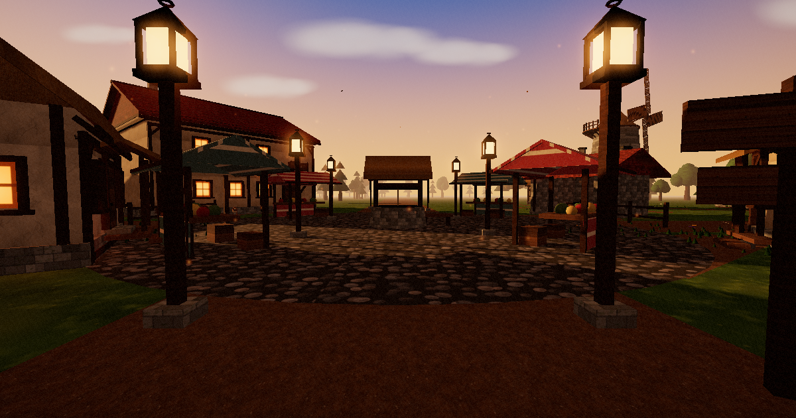

# Шёпот-Долина · Whispervale

**Интерактивная средневековая деревня прямо в браузере.** Тёплый свет, полосатые
навесы, дым из труб, светлячки и колокол, который звонит сам, если его попросить.
Ничего устанавливать не нужно: Three.js + WebGL, играется сразу со страницы.



## Играть в браузере

| Где | Ссылка |
|---|---|
| **Онлайн (основная)** | https://rezare777.github.io/Silenc/ |
| **Зеркало** | https://njoyss18pfynv.space.mcode.io/ |
| **itch.io** | https://rezare777.itch.io/ (страница создаётся вручную, см. ниже) |
| **Однофайловая версия** | `Шёпот-Долина.html` в архиве `whispervale-game.zip` — распаковать и открыть двойным щелчком |
| **Исходники** | https://github.com/REzare777/Silenc (ветка `main`) |

Игра полностью бесплатна, без регистрации и без установки: нужен только браузер
с поддержкой WebGL (Chrome, Edge, Firefox, Яндекс.Браузер).

## Что внутри

- **Деревня** — фахверковые домики, площадь с навесами, колодец, церковь, кузня,
  мельница с винтовой лестницей, амбар с сеновалом, пруд с причалом, ферма;
- **Планировка деревни** — симметричная и «по-человечески»: главная улица
  идёт вдоль Z, у каждого дома есть зеркальная пара на другой стороне,
  между соседними участками — 10–13 м (двор и огород), а от улицы до
  первого ряда — 6+ м. Ни один дом не стоит на дороге, площади, поле или
  другом здании; тропинки идут «лесенкой» от площади к дворам, а за
  каждым домом — огородные грядки;
- **Мельница** — винтовая лестница внутри башни: ступени идут внахлёст
  (в щель между ними больше не провалишься), приводной вал и перила
  ступеней — настоящие препятствия, так что в центр башни не пройти;
- **Храм** — настоящая локация: за дверью колокольни открывается неф с
  каменными стенами, витражами, рядами скамьев, ковровой дорожкой и
  алтарём со свечами; снаружи — дубовая дверь с кольцом, розовое окно и
  колокол, в который можно позвонить;
- **Дома** — у каждой двери железный засов, и подсказка говорит, что хозяева
  не жалуют гостей (тема домов отложена — вернуть её можно одним флагом в
  `src/game/village.js`, `HOUSES_LOCKED`). Исключение — **твой дом**: он стоит
  на поляне у опушки, справа от дороги к пещере (место — как на скриншоте
  игрока: дорога идёт слева, вдали видны фонарь у пещеры и сама скала),
  открыт всегда (хоть днём, хоть ночью),
  а внутри — кровать, на которой можно переночевать: сон лечит раны, сдвигает
  календарь на день и сохраняет игру;
- **Время суток** — идёт само, пока вы стоите: каждый период (утро, день,
  золотой час, вечер, ночь) длится 10 минут, смена плавная, а в углу
  показан текущий период и время до следующего;
- **Трактир** открыт всегда, но трактирщик за стойкой есть только днём —
  с закатом он задувает свечу и уходит спать;
- **Лес** — плотное кольцо вокруг деревни: примерно 3300 деревьев пяти пород
  (сосна, ель, дуб, берёза, осина), подлесок из кустов, папоротника, мшистых
  камней, пней и брёвен, своя тёмная подстилка из мха и прелой листвы. Лес
  начинается в 44 м от центра и полностью закрывает дальний обзор: скала с
  подземельем (≈100 м) с улицы не видна;
- **Таверна** — тёплый интерьер с очагом, объёмной стойкой, бутылками, галереей
  и тремя комнатами-нишами, где можно переночевать; бармен ходит за стойкой.
  Фасад и интерьер — одно и то же здание 15 × 18 м: окна снаружи и внутри
  стоят на одних местах, дверь по центру южного фасада;
- **Подземелье** — отдельная двухъярусная пещера в скале в 100 м от деревни:
  входной зал, кристальный зал с колоннами и светящимися грибами и зал Врат
  на 4.6 м ниже — с алтарём, стражами и огромным самоцветом; руны на стенах,
  туман у пола, своя акустика пещеры. Лестницы в шахте нет: у края стоит
  каменный парапет, а переход между ярусами мгновенный — подошёл, нажал `E`
  и ты на ровном полу; пока печать шахты держит, переход не сработает;
- **Живность** — пёс с командами и прыжком, котик у входа, коровы, овцы, куры,
  утки; все ходят и обходят препятствия;
- **Рыбалка** — две точки заброса с 3D-удочкой, 20 пород рыб пяти уровней редкости;
- **Инвентарь** — сетка-склад на 27 слотов, рюкзак, ящик, полоса быстрого доступа;
- **Товары и торговля** — два торговца: трактирщик Хорт продаёт хлеб, эль, сыр,
  свечи, мёд и соль и берёт улов за полную цену; кузнец Торн торгует оружием
  и забирает лишнее за половину цены. Окно торговли — две колонки: «ваши
  вещи» и «его товары», с ценой, весом и характеристиками;
- **Кузнец Торн** — суровый мужик у горна: широкие плечи, кожаный фартук,
  закатанные рукава, обширная рыжая борода и шрам через бровь. С ним можно
  поговорить, а из разговора — выйти на торговлю;
- **Оружие** — 7 видов: кинжал, короткий и длинный мечи, секира, двуручный
  меч, лук и жезл. У каждого свой урон, замах, дальность и вес; лёгкое бьёт
  чаще, тяжёлое — сильнее. Оружие лежит на поясе, берётся в руки цифрами
  1–9 и показывается настоящей 3D-моделью в кадре;
- **Бой оружием** — удар снимает здоровье тени (у тени 40 единиц здоровья и
  3 единицы стойкости), лук бьёт через пол-деревни, посох тратит ману.
  Бранд по-прежнему работает: он гасит стойкость и не требует оружия;
- **Единый каталог предметов** — рыба, оружие, товары и материалы описаны
  одним способом: у каждого есть вес, цена, иконка и описание;
- **Время суток** — пять пресетов света, колокол, фонари, светлячки, фото-режим.

## Управление

| Клавиша | Действие |
|---|---|
| `W` `A` `S` `D` | ходьба |
| `Shift` | бег |
| `Space` | прыжок |
| мышь | обзор |
| `E` | взаимодействие (дверь, костёр, удочка, бармен…) |
| `I` | инвентарь |
| `1`–`9` | взять предмет из ячейки пояса в руки (оружие — сразу в руку) |
| `ЛКМ` | удар оружием (в подземелье — оружием, а без оружия брандом) |
| `ПКМ` | вспышка факелом (в подземелье) |
| `T` | смена времени суток |
| `P` | фото-режим |
| `O` / `Esc` | меню и настройки (громкость, качество, чувствительность) |

## Как найти игру в интернете

Поисковики находят страницу по мета-тегам `og:` и `application/ld+json`
(тип `VideoGame`), которые лежат в `index.html`. Помогают:

- **GitHub Pages** — страница индексируется Google и Яндексом;
- **itch.io** — крупнейший каталог инди-игр, поиск прямо по названию;
- **GitHub-репозиторий** — описание и ключевые слова в README этого файла;
- **robots.txt / sitemap.xml** — в папке `public/`, указывают путь к карте сайта.

Чтобы ускорить появление в выдаче Google, добавьте адрес
`https://rezare777.github.io/Silenc/sitemap.xml` в
**Google Search Console** (нужна учётная запись Google) и в **Яндекс.Вебмастер**.

## Промо-материалы

Всё для витрины игры собирается двумя командами (нужен `ffmpeg`):

| Команда | Что делает |
|---|---|
| `node scripts/trailer.mjs` | трейлер: кадры настоящей игры → `publish/Шёпот-Долина-трейлер.mp4` (57 секунд, 1280×720, со звуком) |
| `node scripts/itch-assets.mjs` | скриншоты 1280×720 и пакет загрузки для itch.io |

Трейлер собирается из снимков экрана, снятых настоящей игрой (папка `shots/`),
с наездом камеры, перекрёстными затуханиями и подписями сцен; музыка — та же
выгрузка процедурной музыки игры, что лежит в архиве «Шёпот-Долина-музыка».

Текст описания для itch.io — `publish/itch-description.md`. Обложки —
`publish/cover-itch.png` (630×500) и `publish/cover-square.png` (630×630).


## Вход в подземелье

Примерно в ста метрах от деревни, на северо-западе, стоит скала с тёмным
проёмом. К проёму ведёт **каменная дорога через лес** — она выходит из села
с северо-западной стороны, обходит трактир и амбар, а не идёт напролом
через строения. Дорога — сплошное полотно: ни отдельных плит, ни бордюрных
блоков, ни пней-указателей посреди пути, так что её видно с любого
расстояния. Дорога идёт по опушке, где лес уже смыкается, так что скала
не видна с улицы. У скалы — настоящая каменная лестница с перилами: ступени
стоят на земле, поднимаются к порогу, и в проёме светит холодным светом
пещеры. За порогом тоннель закрыт камнем: провалиться внутрь скалы нельзя,
в подземелье ведут только ступени снаружи. Рядом стоит щит с оленьим
черепом и два фонаря.

Справа от дороги, на поляне у опушки, стоит **твой дом** — ровно там, где
стоял игрок на скриншоте: трава, край леса, дорога к скале слева, а вдали
фонарь у входа в пещеру. Фасад повёрнут к дороге, от дома к скале видно, и
к нему ведёт короткий ответвок-тропинка. У крыльца горит фонарь, рядом —
доска для записки (написать на ней можно один раз за всю игру) и пёс,
который ждёт у дома с табличкой. За домом — огород.

## Git и GitHub

## Git и GitHub

Проект уже под git: история раундов, аккуратные `.gitignore` и `.gitattributes`.
Всё, что нужно знать, чтобы работать дальше и перенести проект на GitHub.

### Что уже сделано

- репозиторий инициализирован (ветка `main`), история раундов сохраняется в GitHub;
- `.gitignore` исключает `node_modules`, `dist`, `shots`, `.testlogs` и сгенерированные
  релизы — в репозиторий попадает только исходный код (≈80 файлов, меньше мегабайта);
- `.gitattributes` нормализует переводы строк (в репозитории LF, на Windows — CRLF при checkout);
- лишние файлы никогда не попадут в историю: скриншоты и логи игнорируются.

### Клонировать на свой компьютер и открыть в Visual Studio

```bash
git clone https://github.com/REzare777/Silenc.git
cd Silenc
npm install
npx playwright install chromium   # один раз: браузер для автотестов
npm run build
npm run serve        # локальный сервер сборки на :4205
```

Если Chromium уже стоит в нестандартном месте, укажите путь переменной окружения
`CHROME_PATH` — тесты подхватят его сами (иначе ищут браузер в системном кэше
Playwright).

В Visual Studio 2022 откройте папку проекта (File → Open → Folder) — это обычный
JavaScript-проект, `.sln`/`.csproj` здесь не нужны. В VS Code — `code .`,
в расширении «GitLens» видна история по каждому файлу.

### Рабочий цикл

```bash
git status            # что изменилось
git add -A && git commit -m "Описание изменения по-русски"
git push              # отправить в GitHub
```

### Как перенести проект на GitHub (нужно один раз)

1. На github.com создайте **пустой** репозиторий (без README, .gitignore и лицензии —
   иначе GitHub создаст свои файлы и histories разойдутся). Например: `whispervale-village`.
2. Откройте **Settings → SSH and GPG keys → New SSH key** и добавьте публичный ключ
   машины, с которой идёт push (его выдаст тот, кто готовит перенос).
3. Сообщите адрес репозитория вида `git@github.com:<ваш-логин>/whispervale-village.git`.
4. После этого выполняются две команды:

```bash
git remote add origin git@github.com:REzare777/Silenc.git
git push -u origin main
```

Если ключа под рукой нет, альтернатива — токен GitHub (Settings → Developer settings →
Personal access tokens → Fine-grained, доступ `Contents: read and write`), но SSH-ключ
безопаснее: его можно отозвать в один клик, а токен — нет.

### Проверки перед отправкой

```bash
npm test             # 18 автотестов (--jobs=2, --quick, --only=имя)
npm run release      # сборка → Шёпот-Долина.html + архив исходников
```

Тестам нужен запущенный локальный сервер: `npm run serve` в отдельном окне
(он отдаёт папку `dist`, поэтому после правок кода сначала `npm run build`).

### Автоматика

- агент **SceneKeeper** — точечный надзор за локациями: ищет невидимые стенки, щели
  и сломанную геометрию, чинит и прогоняет тесты;
- ночная задача «Ночной контроль „Шёпот-Долины“» (ежедневно в 4:17) — поднимает сервер,
  прогоняет все тесты, при зелёном результате собирает релиз и делает коммит.

## Запуск

Самый быстрый способ — **один файл**: `npm run build:single` создаёт
`whispervale.html`, который открывается двойным щелчком прямо с диска
(ни сервера, ни интернета не нужно).

```bash
npm install
npm run dev        # http://localhost:5173 — режим разработки
npm run build      # сборка в dist/
npm run preview    # локальный просмотр сборки
npm run build:single  # один самодостаточный html-файл
```

> ⚠️ Папку `dist/` нельзя открывать двойным щелчком: браузер блокирует
> ES-модули на `file://` (CORS для origin `null`). Либо используйте
> `whispervale.html`, либо отдавайте папку любым статическим сервером:
> `npx serve dist`.

## Как открыть и продолжить работу в Visual Studio

Проект — **обычный веб-проект на JavaScript + Vite**, а не C#. Файла `.sln`
и проекта `.csproj` здесь нет и они не нужны: Visual Studio всё равно откроет
папку, а отладка пойдёт через браузер.

### Вариант 1. Visual Studio Code (рекомендуется)

1. **File → Open Folder…** → выберите папку проекта (ту, где лежит `package.json`).
   Именно *папку*, а не отдельный файл — иначе редактор не подхватит
   `node_modules` и настройки.
2. В терминале редактора (`Ctrl + \``) выполните:

   ```bash
   npm install
   npm run dev
   ```

3. Откройте адрес, который напечатает Vite (обычно <http://localhost:5173>).
   Изменения в коде применяются сразу — страница перезагрузится сама.

### Вариант 2. Visual Studio 2022

1. **File → Open → Folder…** (или **Open → Web Site…**) → выберите папку проекта.
2. Visual Studio подхватит `package.json` и предложит восстановить пакеты NuGet —
   откажитесь, это не нужно: зависимости ставит npm.
3. Установите **Node.js development tools**: *Tools → Options → Web → Web
   performance* или расширение *Microsoft JavaScript and TypeScript SDK*.
4. Запустите проект из терминала Visual Studio:

   ```bash
   npm install
   npm run dev
   ```

   Либо через **Task Runner** (правый клик по `package.json` → *Scripts* →
   *dev* → *Run Script Task*).

### Что помогает в редакторе

| Файл | Зачем он |
|---|---|
| `.editorconfig` | единые отступы (2 пробела), кодировка UTF-8, перевод строки LF |
| `jsconfig.json` | подсказки, переходы по коду и проверка путей импортов |
| `src/main.js` | точка входа: сборка систем и игровой цикл |
| `src/game/*.js` | сами системы игры (см. карту ниже) |

### Полезные команды

```bash
npm run dev            # сервер разработки с горячей перезагрузкой
npm run build          # production-сборка в dist/
npm run preview        # посмотреть собранную версию
npm run build:single   # один html-файл, открывается двойным щелчком
```

### Автотесты

В папке `dev/` лежат сценарии Playwright, которые проверяют игру в реальном
браузере (прыжок, столкновения, лестницы, ловля, инвентарь, свет таверны и
многое другое).

Готовый прогонщик запускает их сам, поднимает нужный сервер и печатает сводку:

```bash
npm test              # весь набор (16 тестов, ~12 минут)
npm run test:quick    # быстрая проверка после правки (3 теста)
npm test -- --only=fish_test,inv_test   # только выбранные
npm test -- --jobs=2  # два браузера одновременно (быстрее, но нагружает CPU)
```

Прогонщик запускает тесты **по-настоящему параллельно** (через `spawn`, а не
`spawnSync`), поэтому `--jobs=2` действительно вдвое ускоряет прогон.

Перед тестами прогонщик запускает **статическую проверку модулей**
(`dev/lint-scopes.mjs`): она ищет обращения к полям контекста вроде `scene`
или `M`, к которым забыли приписать `ctx.` — самый частый класс ошибок при
работе с модульной структурой. Проверка занимает меньше секунды и ловит
ошибку до запуска браузера.

Отдельно любой тест можно запустить вручную из папки `dev`:

```bash
cd dev
node regress.mjs        # общий регресс
node barn_test.mjs      # лестница в амбаре
node tavern_test.mjs    # интерьер таверны
node volume_test.mjs    # громкость и тумблер звука
```

Тестам нужен локальный статический сервер из папки `dist` — прогонщик
поднимает его сам, вручную это `npm run serve` (http://127.0.0.1:4205).

### Релиз

Одна команда собирает всё, что можно отдать пользователю:

```bash
npm run release
```

Она делает: production-сборку в `dist/` → однофайловый `whispervale.html` →
копии `Шёпот-Долина.html` и `whispervale-village.zip` в рабочую папку →
проверку целостности архива → обновление чистой папки `srcpkg` с исходниками
для публикации.

## Частые задачи: где что менять

| Хочу изменить | Файл | Что именно |
|---|---|---|
| Вид домов, крыш, окон | `src/world/buildings.js` | функции `cottage`, `church`, `barn`, `windmill`, `tavern`, `blacksmith` |
| Текстуры (дерево, камень, штукатурка) | `src/world/textures.js` | `buildTextures()` |
| Цвета и оттенки материалов | `src/world/materials.js` | `buildMaterials(T)` |
| Модели животных и их анимация | `src/world/animals.js` | `chicken`, `sheep`, `duck`, `dog`, `cat` |
| Поведение животных, команды пса | `src/game/animals.js` | `update()`, `ui.onDogCommand` |
| Рыбы и шансы ловли | `src/world/fish.js`, `src/game/fishing.js` | `FISH`, `HOOK_CFG`, `rollFish()` |
| Пруд, причал, дороги | `src/game/terrain.js` | `addPond()`, `addRoads()`, `POND` |
| Где стоит здание | `src/game/layout.js` | `LAYOUT` — читают его и деревня, и локации |
| Действия по клавише E | `src/game/interactions.js` + модули | `interactions.add(...)` |
| Интерьер таверны | `src/world/tavern.js` | `buildTavernInterior()` |
| Интерьер амбара | `src/world/barn.js` | `buildBarnInterior()` |
| Настройки окна (звук, качество) | `src/game/settings.js`, `src/ui.js` | `bindSettings()`, разметка в `index.html` |
| Свет и время суток | `src/world/environment.js` | класс `Environment` |
| Игровое время и кадр | `src/main.js` | функция `loop()` |

## Карта проекта

```
village/
├─ index.html            разметка интерфейса (HUD, меню, инвентарь)
├─ package.json          зависимости и команды npm
├─ vite.config.js        настройка сборки
├─ jsconfig.json         подсказки и пути импортов для редактора
├─ .editorconfig         общий стиль кода
├─ scripts/
│  ├─ build-single.mjs   сборка одного html-файла
│  └─ release.mjs        полный релиз: сборка → копии → архив (npm run release)
├─ src/
│  ├─ main.js            ← точка входа: сборка систем и игровой цикл
│  ├─ player.js          игрок: движение, прыжок, вертикальные лестницы, камера
│  ├─ ui.js              интерфейс: HUD, окно настроек, инвентарь
│  ├─ audio.js           звуковая среда (WebAudio)
│  ├─ nav.js             сетка проходимости и поиск пути (A*)
│  ├─ inventory.js       модель инвентаря
│  ├─ fishview.js        просмотр пойманной рыбы в 3D
│  ├─ game/              ← системы игры, каждая в своём файле
│  │  ├─ context.js      общий контекст (GameContext) — то, что видят все системы
│  │  ├─ layout.js       единая планировка: где стоит какое здание
│  │  ├─ terrain.js      земля, дороги, пруд, причал и удочки
│  │  ├─ village.js      здания (дома, таверна, церковь, амбар, мельница, кузня) и пропсы
│  │  ├─ animals.js      куры, овцы, утки, пёс, кот и команды пса
│  │  ├─ fishing.js      заброс удочки, мини-игра ловли, редкости рыб
│  │  ├─ locations.js    переходы «улица / амбар / таверна / подземелье», NPC
│  │  ├─ interactions.js реестр действий по клавише E
│  │  ├─ bag.js          открытие и закрытие инвентаря
│  │  ├─ settings.js     качество, свечение, громкость, чувствительность
│  │  └─ debug.js        визуализация границ столкновений (клавиша C)
│  └─ world/             ← геометрия и материалы мира
│     ├─ textures.js     процедурные текстуры (дерево, штукатурка, камень…)
│     ├─ materials.js    материалы
│     ├─ buildings.js    дома, таверна, церковь, амбар, мельница, кузня, колодец
│     ├─ props.js        деревья, трава, цветы, заборы, фонари, удочки
│     ├─ animals.js      модели животных и их анимация
│     ├─ barn.js         интерьер амбара
│     ├─ tavern.js       интерьер таверны
│     ├─ dungeon.js      интерьер подземелья: пещера, кристаллы, туман, Врата
│     ├─ npc.js          модель бармена и портрет для диалога
│     ├─ fish.js         каталог рыб (20 пород)
│     ├─ environment.js  небо, солнце, погода, время суток
│     ├─ particles.js    дым, угли, светлячки, пылинки, листья
│     └─ bloom.js        мягкое свечение
└─ dev/                  автотесты на Playwright, прогонщик и локальный сервер
   ├─ run-tests.mjs      прогон всех тестов со сводкой (npm test)
   ├─ lint-scopes.mjs    статическая проверка модулей (ловит «забытый ctx.»)
   ├─ wall_scan.mjs      сверка коллайдеров с видимой геометрией («невидимые стенки»)
   ├─ niche_check.mjs    где именно упирается игрок (точки рядом + геометрия)
   ├─ niche_grid.mjs     сетка застреваний по нишам второго этажа
   ├─ niche_debug.mjs    покадровая трассировка движения (куда упирается)
   ├─ bar_shots.mjs      ракурсы для скриншотов бара и галереи
   ├─ niche_shots.mjs    ракурсы для скриншотов ниш-комнат и выхода из лестницы
   ├─ bed_shots.mjs      крупные планы кроватей (диагностика и правка)
   ├─ npc_test.mjs       автотест бармена и диалогового окна
   ├─ npc_shots.mjs      ракурсы для скриншотов бармена и диалога
   ├─ dungeon_test.mjs   автотест подземелья (вход, свет, выход)
   ├─ dungeon_shots.mjs  ракурсы для скриншотов пещеры и входа
   ├─ barn_shots.mjs     ракурсы второго этажа амбара
   ├─ live_check.mjs     проверка задеплоенной версии (LIVE_URL=… node dev/live_check.mjs)
   └─ serve.py           локальный сервер сборки (порт 4205)
```

### Как это устроено

`src/main.js` — только **сборка**: он поднимает рендер, создаёт системы и
запускает игровой цикл. Вся содержательная логика живёт в `src/game/` и
`src/world/`.

Все системы общаются через **контекст игры** (`src/game/context.js`) —
один объект, в котором лежат сцена, материалы, игрок, реестр действий и
коллайдеры. Системы не импортируют друг друга напрямую: это исключает
циклические зависимости и делает код читаемым.

Чтобы добавить, например, новое действие по клавише E:

```js
// в подходящем модуле src/game/
ctx.interactables.push({
  pos: new THREE.Vector3(0, 1.2, 0),
  radius: 2.8,
  label: 'Набрать воды',
  act: () => ui.toast('Вода из колодца — ледяная и чистая.'),
});
```

Чтобы добавить новую локацию — заведите сцену в `src/game/locations.js` и
добавьте её в переключатель `setLocation`.

## Управление

| Клавиша | Действие |
|---|---|
| `W A S D` / стрелки | ходьба |
| `Shift` | бег |
| `Space` | прыжок |
| мышь | обзор (клик по сцене — захват курсора) |
| `E` | взаимодействие: фонари, колодец, костёр, колокол, ворота амбара, панель команд пса; заброс удочки (если смотрите на удочку) |
| `T` | смена времени суток (утро → день → золотой час → сумерки → ночь) |
| `O` | панель настроек |
| `P` | фото-режим (прячет интерфейс) |
| `M` | звук |
| `I` | инвентарь (27 слотов + пояс) |
| `1`–`9` | выбрать слот пояса |
| `Esc` | пауза (окно с настройками и временем суток) |
| `C` | показать границы столкновений (отладка) |

На телефоне появляется виртуальный джойстик: слева — движение, справа — обзор.

## Животные

Все модели построены процедурно из примитивов — в том же стиле, что и деревня,
поэтому стыковка не выбивается, а файл остаётся лёгким. Особей немного, зато
каждая ведёт себя по-своему:

| Животное | Где | Поведение |
|---|---|---|
| куры (4) | площадь у колодца | щиплют траву, разбегаются, если подойти вплотную |
| овцы (3) | луг у амбара | пасутся, опускают голову, изредка переступают |
| утки (3) | пруд | бродят по воде, оглядываются, чистят пёрышки; от хозяина уплывают и машут крыльями |
| собака (1) | у таверны | гуляет, а если игрок рядом — подбегает и виляет хвостом |
| кот (1) | крыльцо домика | сидит, следит за игроком, шевелит хвостом |

## Озеро и причал

- песчаный берег, тёмное дно и вода с градиентом глубины — от берега к центру;
- камыш по кромке, кувшинки с цветками, камни и валуны на берегу;
- пирс из досок на сваях: перила, площадка в конце и удочка для рыбалки;
- по настилу можно пройти к воде, а свалиться в озеро нельзя — по краям стоят
  невидимые бортики настила.

## Жизнь в долине

Животные — полноценные объекты мира: игрок не может пройти сквоз них, а сами они
не проходят сквозь стены, заборы и деревья — каждый шаг проверяется, и при
препятствии животное поворачивает или ищет обход.

## Домики

Каждый дом проверен и подчищён — убрано всё, что мешало читать объём:

- окна переделаны в настоящие проёмы: глубокая откосная рама, стекло утоплено
  в откос, подоконник выступает — раньше окно было плоской светящейся картинкой;
- косые раскосы фасада больше не режут окна: в домиках их убрали совсем, у таверны
  оставили только в свободных проёмах у углов;
- дверь — косяки, перемычка, створка и порог вместо сплошной доски на доске;
- крыльцо сузили, лишнюю балку под свесом убрали, лишние обвязки по бокам сняли.

## Крыши: без мерцания, с толщиной и стропилами

Крыши пересобраны целиком — раньше они состояли из набора отдельных плоскостей,
которые местами совпадали друг с другом (z-fighting) и потому мерцали:

- **новая оболочка** `roofShell()` в `src/world/geo.js`: внешние скаты, внутренние
  скаты (дощатый потолок, сдвинутые на толщину кровли) и торцы (карнизные и
  фронтонные). Все поверхности разнесены по толщине — совпадающих плоскостей нет,
  мерцание исчезло;
- **нормали согласованы с витой обходом** треугольников (иначе скаты освещались
  «наоборот»); вырожденных треугольников и битых нормалей — 0;
- **толщина кровли**: солома 0,36 м, черепица 0,2 м — видно на карнизе и на
  фронтоне;
- **стропильные выпуски и карнизная доска** под каждым карнизом;
- **конёк**: брус + соломенный гребень (округлёный) на соломенной крыше;
- потолок теперь идёт по самим скатам (без отдельной плоской панели), поэтому
  изнутри крыша видна под наклоном, как настоящая;
- отдельно убрана **внутренняя обшивка фронтонов** — она лежала в одной
  плоскости со стеной и давала вторую причину мерцания.

Прилавки, крыльцо, колодец, кузня и церковь переведены на ту же оболочку.

### Мельница

В башне **нет пола**: настил и мостик убраны, осталась только смотровая
площадка с забором. Крыша возвращена — соломенный конус с **люком** напротив
лестницы (≈60°), так что крыша выходу на площадку не мешает: изнутри башни
видно и небо, и конус, а с площадки можно выйти наружу через проём. В перемычку
между последней ступенью и площадкой добавлена площадка лестницы.

### Что ещё чинили в крышах

- **фронтоны** (торцевые стенки) — из кровельного материала и по полной глубине
  крыши; раньше они делались из стенового материала и не доходили до скатов,
  поэтому торцы выглядели как штукатурный треугольник, а сквозь щели было
  видно небо;
- **стены и кровля двухсторонние** (`side: DoubleSide`): раньше грани блоков были
  односторонними, и изнутри здания было видно насквозь — сквозь стены на улицу
  и сквозь крышу на небо;
- свет из окон домов и таверны светит внутрь (окна добавлены в общий пул
  точечных огней) — в комнатах не темно.

Церковь и амбар — цельные каменные/дощатые объёмы, у них интерьера нет.

### Кузня

Горн и наковальня стали **настоящими препятствиями**: игрок не проходит сквозь
них, а вокруг них можно ходить.

## Мельница

Мельница стала проходимым зданием — в неё можно войти и подняться на смотровую площадку:

- башня полая: каменные стены с настоящим проёмом-входом, внутри каменный пол
  и подвесные фонари;
- **башня стала выше** — высота 11,6 м вместо 9,6, радиус 3,5 м: силуэт читается
  как настоящая мельница, а смотровая площадка поднялась до 11,6 м;
- винтовая лестница на 40 ступеней вокруг центральной стойки ведёт с первого этажа
  прямо на смотровую площадку (11,6 м) — настила в башне больше нет;
- лестница сделана «нормально физической»: это не стопка коробок, а непрерывная
  винтовая поверхность — игрок катится вверх плавно, без рывков и застреваний;
  виток запоминается, поэтому на стыке витков высоты не «перескакивают»;
- с настила — выход на круглую смотровую площадку с деревянным забором:
  столбы через ~0,8 м, две продольные перекладины, проём у двери;
  с площадки видно всю долину, а крылья проходят рядом;
- убрана прежняя «макушка» с наружной лесенкой: от верха башни остались только
  соломенный конус крыши и площадка с забором;
- в проёме входа — распахнутая створка; других окон у мельницы нет.

**Вращающийся аппарат присоединён к зданию.** Соломенная шапка стоит прямо на
башне, а ступица крыльев и приводной вал крепятся к самой шапке — крылья крутятся
прямо на мельнице. Никакой палки, торчащей рядом: ничего не висит отдельно.

**Крылья вынесены вперёд, паруса не заходят внутрь здания.** Ступица с крестовиной
и парусами стоит перед башней (на 0,9 м дальше обода шапки) и вращается в своей
плоскости перед зданием:

- длинной мачты-«палки», на которой держались паруса, больше нет — паруса крепятся
  прямо к крестовине короткими кронштейнами;
- на фронте соломенного конуса — щит с подшипником: доска в обвязке, железное кольцо
  и подкос вала; вал уходит в шапку, а ступица с крестовиной — наружу;
- проверено расчётом: при полном обороте крестовины ближайшая точка паруса до
  поверхности башни — **0,49 м**, то есть паруса физически не входят в здание
  и не задевают стены;

Внутри башни — **приводной вал в центре, вокруг которого идёт винтовая
лестница**: на валу шкив и кожаный привод, внизу — каменный жернов с воронкой
для зерна и мешки с зерном. В башне горит фонарь у жернова и лампа наверху,
так что внутри видно и днём.

У башни каменный цоколь с карнизом, пояс-карниз на втором поясе и небольшой
навес над дверью; по ободу соломенного конуса — деревянный ободок.
**Окон у мельницы нет** — только проём входа.

Под смотровой площадкой — **диагональные раскосы**: каждый идёт от стены
башни внизу вверх к краю настила, плюс горизонтальная распорка. Раньше
кронштейны стояли криво и торчали вбок «шипами» — теперь площадка
подпирается по-настоящему и не выглядит сломанной.

## Пруд и пирс

Пруд переехал на юго-восточную лужайку (50, −14) — теперь он не соприкасается
с домами (до ближайшего строения 8–11 м) и открыт вид из центра деревни:

- песчаный берег, тёмное дно, вода с градиентом глубины, анимация поверхности;
- камни, камыш, кувшинки и водяные лилии по кромке;
- пирс на сваях: доски, перила, площадка в конце; по настилу можно пройти
  к воде, с пирса в воду не свалиться, а с берега вода не пускает.

## Столкновения

Каждый видимый предмет — настоящее препятствие, без «невидимых» стенок вокруг:

- стены домов считаются по точному контуру здания (повёрнутые прямоугольники), а не по
  осевой ограничивающей рамке — в углах не появляется лишних пустот;
- заборы, столбы, бочки, ящики, поленницы, телеги, поилка, колодец, стоги, деревья,
  прилавки и столбы навесов — всё останавливает игрока ровно там, где видно предмет;
- животные тоже преграда: овцы пасутся, куры разбегаются, если к ним подойти;
- крыльца, ступени и пороги — настоящие площадки: на них можно подняться, а сойти
  с них — спрыгнуть вниз;
- площадки и препятствия умеют работать по высоте: перекрытие второго этажа
  над входом не мешает ходить по первому, а настил мельницы не «подбрасывает»
  игрока снизу — на винтовую лестницу он попадает только поднявшись по ней;
- в огорожённых полях есть калитки, поэтому до любого угла карты можно дойти
  пешком (проверено обходом: проходимость карты — 99,9 %; единственная «недостижимая»
  область — внутренность башни мельницы, у которой вход снизу, а обход идёт по земле);
- `C` показывает границы столкновений — видно, что каждому предмету соответствует
  ровно его силуэт.

## Амбар — отдельная локация

Амбар больше не «ящик в дальнем углу карты», а самостоятельное место: у ворот
появляется подсказка **«E — Войти в амбар»**, и игрок оказывается внутри
другой сцены, а на обратной двери — **«E — Выйти из амбара»**.

Внутри — настоящий деревенский амбар 13 × 9 м на каменном цоколе:

- **стены как в деревне** — оштукатуренные, с фахверком: стойки, обвязка,
  раскосы в углах; окна с откосом, рамой и переплётом;
- **ворота закрыты** — створки с железными полосами, петлями и кольцом;
  за ними глухая зашивка, так что белого света из проёма не видно;
- **сеновал во всю ширину** — сплошной настил над первым этажом (сквозь него
  не пройти), с люком для сена и перилами вокруг люка; настил разбит на
  сегменты с проёмом под вертикальную лестницу;
- **настоящая вертикальная лестница** — у западной стены, наглухо в стену:
  две стойки, 15 перекладин, крюки в кладку. Игрок залезает по ней **вверх**:
  подойдите к лестнице, **посмотрите вверх** и жмите **W** — игрок поднимется
  по перекладинам и наверху автоматически перелезет через люк на сеновал;
  спуск — **посмотреть вниз** и жмить **S**;
  это отдельный тип «зоны подъёма», а не наклонная поверхность, поэтому
  подъём не срывается и не проваливается сквозь настил;
  проверено автотестом: подъём с пола (0 м) на сеновал (4,3 м) — без падений,
  спуск обратно — тоже без рывков;
- лестница выходит на сеновал через **отдельный люк** в настиле (проём в западной
  полосе), а в центре сеновала есть **второй люк для сена** с перилами — два
  разных проёма, спуститься можно и по лестнице, и через сеновал;
- перед лестницей **не осталось бочек** — проход к ней свободен: весь хлам
  стоит у восточной стены, бочка у ворот тоже убрана;
- первый этаж: каменный пол, ящики у задней стены, мешки у правой, поленья
  в углу, верстак с вилами и лопатой, метла и две повозки; на сеновале — рулоны
  сена;
- **загон для скота** — отдельная перегородка в углу первого этажа: доски на
  стойках, широкий проём для входа, кормушка и поилка внутри. Это настоящая
  преграда: сквозь стенку загон не пройти, только через проём;
- **все стойки фахверка — препятствия**. Раньше сквозь них можно было
  пройти, хотя выглядели они как стены; теперь каждая стойка имеет
  коллайдер, и в проёме ворот проём остаётся проходом;
- стены обшиты **деревянной вагонкой** до уровня груди, снизу идёт плинтус,
  на стойки наклеены накладки с заклёпками — стены перестали выглядеть
  «бумажными».

Свет внутри живой: он берёт значения из текущего времени суток основной
локации — днём в амбар заливает солнце, на закате теплеет, ночью горят четыре
подвесных фонаря, а через люк сеновала падает световой столб. Лампы чуть
подрагивают, как настоящий огонь.

Весь хлам, который раньше валялся по деревне (28 предметов и 2 телеги),
убран внутрь амбара — в центре деревни теперь пусто.

## Таверна «Уставший вепрь» — отдельная локация

Таверна перестала быть просто зданием с надписью. Теперь это **третья
локация** рядом с деревней и амбаром: подойдите к двери с пивной кружкой на
вывеске, наведитесь на дверь и нажмите **E** — откроется **«Войти в таверну
„Уставший вепрь“»**, и игрок окажется внутри отдельной сцены. Обратно —
**E** у двери в глубине зала: **«Выйти из таверны»**, и вы снова в деревне
у таверны.

Снаружи таверна узнаётся по кронштейну с кружкой и бочке у входа.
Внутри таверна стала просторнее: здание расширено в глубину, за баром
появилась **кухня** — печь с котлом над огнём, стеллажи с утварью,
рабочий стол повара, бочки и мешки, — а в середине зала стоит **общий
трактирный стол** с лавками.

Внутри — 15 × 13 м, три уровня по высоте, всё из дерева, камня и огня:

- **каменный очаг** в западной стене — ниша с кладкой, мантелем, свечами,
  живым огнём (языки пламени мерцают, свет от него пульсирует), углями в
  топке, поленницей, треножником с котлом, кочергой и поленом;
- **массивная стойка бара**: каменный цоколь (стойка стоит, а не висит),
  корпус с **филёнками в рамах**, фигурные торцы с башмаками, карниз под
  столешницей, столешница с выступом и **медной каймой**. На столешнице —
  **живые мелочи**: ряд бутылок, костёр для монет с латунным замком, свеча в
  подсвечнике, тарелка с закусками (сыр, хлеб, окорок), свёрнутое полотенце
  и свиток. За стойкой — **три полки и около шестидесяти бутылок** разного
  цвета (тёмный эль, зелёное вино, прозрачная водка), медный подножник для
  ног, барные табуреты и бочки;
- **южная часть бара (внутри стойки) — закуток бармена**: открытый
  **шкаф-витрина** с полками и рядами бутылок, **бочка-калда с медным краном**
  и кружкой под ним, ящик с припасами, а на стене — **картина с силуэтом
  вепря** в тёмной раме с латунной табличкой;
- **второй этаж — буквой «Г»**: настил идёт вдоль северной стены и
  разворачивает крылом над стойкой бара. Настил стоит на **настоящих
  деревянных колоннах** — каменный базис, ствол, капитель и раскосы;
  у западной стены опоры нет (там лестница и зона подъёма);
- **зал перед нишами**: общая зона второго этажа **полностью свободна** —
  столики из зала убрали, чтобы от ниш к лестнице и балкону шёл спокойный
  проход. По стене остались только сундуки и подсвечники;
- **ниши уходят вглубь**: комнаты не прижаты к стене, а вмурованы в
  толщу здания — в них кровать у дальней стены, своё окно со шторой и
  фонарь;
- **три отдельные комнаты-ниши** на втором этаже — как в средневековой
  таверне: они **вмурованы вглубь здания** (ниша уходит на 3 метра от
  стены до северной стены), а их входные стенки — **одна общая стена с
  тремя дверями**. В каждом проёме — **портьера** (ткань на железном
  карнизе со складками), **две створки двери, открытые внутрь ниши** (с
  петлями, заклёпками и кольцом-ручкой), светлая перекладина и **медный
  щиток** с номером комнаты; у двери горит **настенный подсвечник**.
  Проём остаётся проходимым: створки прижаты к косякам, портьера висит
  над головой. Боковые перегородки ниш глухие — из зала в нишу можно
  попасть только через дверь. В каждой нише:
  - **кровать вдоль западной перегородки** — головой к стене: тёмный каркас
    на четырёх ножках, четыре борта, доска изголовья с карнизом, матрас,
    зелёная простыня, красное одеяло с загнутым краем, светлая подушка и
    сложенное полотенце в ногах. Каждая деталь лежит на предыдущей
    (борта → матрас → простыня → одеяло), ничего не висит в воздухе и не
    утоплено в ткань. Кровать стоит головой к стене, поэтому от двери до
    окна идёт свободная полоса шириной больше метра;
  - **маленький столик** со свечой, кружкой и свитком — у восточной
    перегородки, в привходовой части;
  - **сундук** в западном углу у входа, **табурет** у окна и **ночник**
    на стойке (с тёплым огоньком);
  - **коврик** перед кроватью;
  - подвесной фонарь — в каждой комнате свой;
- **«Переночевать»** — подойдите к кровати и нажмите **E**: хозяин устроится
  на ночь, а в мире наступит утро (время суток меняется и на улице);
- на западной стене второго этажа — **картины в рамах** и **полка с кружками**:
  пустой стене не остаётся места;
- **столы, лавки и табуреты**, ковёр в центре, миски, кружки и свечи;
- **мешки, ящики, цветы, лютня** на стене;
- **деревянные балки** под потолком и на стенами — тёплый, «деревянный» объём;
- **стены обшиты вагонкой** до пояса, снизу плинтус, на стойках — накладки с
  заклёпками. **Все стойки фахверка стали препятствиями**: раньше сквозь
  них можно было пройти.

### Проверка «невидимых стенок»

Все преграды в интерьере сверяются с видимой геометрией: для каждого
коллайдера берутся точки внутри его объёма и проверяется, есть ли рядом
поверхность. Раньше на краю галереи стояли **четыре коллайдера без единой
видимой опоры** (и пятый — прямо в зоне подъёма по лестнице): игрок упирался
в пустоту. Теперь на этих местах стоят настоящие колонны, а коллайдеры
совпадают с видимыми столбами.

Три причины «стен в пустоте» убраны в этом раунде:

- **круглые коллайдеры без высоты** (бочки, мешки, табуреты) действовали на
  **любом этаже**: бочка на первом этаже держала игрока в нише второго.
  Теперь у каждого круглого препятствия задан диапазон высот, а в движке
  круг без высоты считается «земным» (до 2,5 м) — так больше не выходит;
- **перила галереи** были решёткой из балясин, а коллайдер — сплошной:
  игрок упирался в пустоту между балясинами прямо у выхода из лестницы.
  Теперь низ перил — **сплошной парапет**, и он совпадает с коллайдером;
- **мебель в нишах** стояла поперёк комнаты: кровать смыкалась со столом, и
  прохода к окну не было вовсе. Теперь кровать стоит **вдоль перегородки**,
  а стол, сундук и табурет — у краёв: свободная полоса к окну больше метра.

Проверено автотестом: из каждой ниши игрок доходит до окна, из каждой точки
выхода из лестницы есть куда идти, а коллайдеров без видимой геометрии на
втором этаже — **ноль**.

### Как устранено мерцание текстур

Раньше в интерьере таверны текстуры «дышали» и подёргивались при движении.
Причина была геометрическая, а не в настройках рендера:

- **ковёр и коврики** лежали плоскостью в 8–12 мм над досками — две
  поверхности почти на одной глубине и рисунок пола «просвечивал» сквозь
  ткань. Теперь это объёмные плиты, нижняя грань утоплена в пол;
- **обшивка стен** была утоплена внутрь стены (её не было видно), а её
  задняя грань оказывалась в сантиметре от грани стены. Теперь обшивка
  лежит на стене снаружи, а её задняя грань уходит в стену;
- **косяки дверей ниш** стояли ровно в той же точке, что и стойки проёмов, —
  теперь косяки вынесены вперёд;
- **накладки на стойках** были внутри самих стоек — теперь лежат на
  поверхности;
- **подушка, одеяло и свёрток** на кровати уходили в матрас по высоте —
  теперь лежат на матрасе;
- **складки портьеры** отодвинуты от полотна, чтобы ткань не «спорила»
  сама с собой на сгибах;
- **у всех текстур включена анизотропная фильтрация** (16x): без неё
  мипмапы «кипят» на больших плоскостях при движении камеры.

### Свет внутри постоянный

Внутри таверны **свет не зависит от времени суток на улице**. У таверны своя
палитра, свой фон и своя дымка: сколько бы часов ни стояло за окном, внутри
всё время один и тот же тёплый вечер — очаг горит, подвесные фонари дают
ровный свет (шесть на первом этаже и пять на втором), от пола и стойки идёт
отсок. Проверено автотестом: при
смене времени суток «ночь → день» все источники света внутри дают **одни и
те же** значения.

### Окна завешены шторами

Все окна таверны закрыты **шторами** — тяжёлое полотно в складках, ламбрекен,
подшивка по низу и кольца на железном карнизе. За шторой не видно ни неба, ни
улицы: поэтому атмосфера внутри всегда одинаковая. Шторы висят и на нижних
окнах, и на высоких окнах над галереей.

Шторы переделаны с нуля, потому что старые «шлифовали» глаз:

- полотно теперь **одна цельная плоскость**, а складки — объёмные полосы
  двух близких оттенков. Раньше полотно собиралось из пяти плоскостей в
  одной плоскости, они друг в друга впивались (z-fighting, мерцание);
- тёмные «швы» из дерева, которые выглядели палками, убраны — объём дают
  сами складки;
- кольца висят **по ширине полотна**, а не шире его на метр;
- за шторой лежит **тёмная подложка** — раньше сквозь ткань было видно
  оконную раму и переплёт;
- полотно шире проёма, но не на пол-стены: раньше оно закрывало пол-комнаты
  и комнаты выглядели полосатыми.

## Первый персонаж: бармен трактира

В таверне «Уставший вепрь» появился живой человек — **Хорт, бармен**.

### Внешность

Модель процедурная, собрана из примитивов в том же низкополигональном стиле,
что деревня и животные (никаких внешних файлов — иначе однофайловая сборка
раздуется и стиль развалится):

- грузная фигура бармена ростом около 1,9 м: светлая рубаха с воротником и
  манжетами, широкие покатые плечи, бордовый жилет с расходящимися полами,
  лацканами и пуговицами в одну колонку, кремовый фартук с завязками через
  плечи, поясом, карманом и латунной табличкой;
- лицо собрано из объёмных деталей: широкий череп, челюсть, затылок, плоские
  уши, нос с горбинкой, глаза с белком, радужкой, зрачком и бликом, веки,
  объёмные брови, рыжеватая борода, усы-«козлики» с опущенными кончиками и
  добродушная ухмылка;
- тёмный колпак с валиком, красной лентой и сбитым набок верхом;
- кисти с пальцами и большим пальцем, сапоги с голенищами и подошвой;
- оловянная кружка с пеной и ручкой в правой руке.

Он не «стоит колом»: шагает с настоящим сгибом коленей и качанием рук,
дышит грудной клеткой, моргает, разворачивается к гостю, жестикулирует в
разговоре, а в перерыве между гостями пьёт эль из кружки.

### Где он

Работает в закутке за стойкой: ходит по трём точкам вдоль бара
(северная часть, южная часть, середина), останавливается на паузу, ждёт
гостей и всегда смотрит в зал. Над его рабочим местом висит фонарь —
бармен хорошо виден в тёплом свете и не теряется среди бутылок.

### Разговор

Подойдите к стойке и нажмите **E** — откроется диалоговое окно:

- портрет (нарисован на canvas, как иконки рыб);
- имя **Хорт** и титул **бармен**;
- его реплика;
- темы разговора: о трактире, о зверье, о рыбалке, о погоде, о гостях,
  о селе, о вине — и кнопка **Покинуть**;
- **Esc** — закончить разговор.

Пока открыт диалог, игра остановлена, а курсор освобождён.

### Ночью его нет

Бармен уходит на ночь: если мировое время суток — **ночь**, его не видно
в таверне (приходит тост «Хорт ушёл спать»). С наступлением утра он
возвращается на работу. Свет внутри таверны при этом остаётся постоянным —
гаснет только хозяин.

### Где лежит код

| Файл | Что внутри |
|---|---|
| `src/world/npc.js` | модель бармена и портрет для диалога |
| `src/game/npc.js` | поведение: маршрут, шаг, поворот, разговор, уход на ночь |
| `src/game/dialog.js` | сценарий и реплики, открытие и закрытие окна |
| `src/game/locations.js` | создание бармена в сцене таверны и точка взаимодействия |
| `src/ui.js` | само окно: портрет, имя, реплика, кнопки тем |
| `dev/npc_test.mjs` | автотест NPC и диалога |
| `dev/npc_shots.mjs` | ракурсы для скриншотов бармена и диалога |

## Пёс: команды

Подойдите к псу и нажмите **E** — откроется панель с четырьмя командами:

| Команда | Что делает |
|---|---|
| **Стой тут** | пёс садится на месте и ждёт приказаний |
| **Иди туда** | включается прицел: обзор мышью без движения, клик по земле — и пёс идёт туда по маршруту |
| **За мной** | пёс снова ходит за хозяином по настоящему пути (A*) |
| **Прыжок** | пёс подпрыгивает на месте с анимацией: корпус и уши улетают вверх, передние лапы поджимаются, хвост взлетает |

Пёс ещё и лает: на каждую команду — свой лай, а когда хозяин рядом, пёс
иногда подаёт голос сам.

## Котик у входа

Кот сидит на крыльце дома у церкви — там, где перед дверью открытое место.
Переделан с нуля: процедурная текстура шерсти-табби
(полосы, пятна и 5200 штрихов ворса), зелёные глаза с вертикальным зрачком,
блеском и веками, розовый нос и подушечки пальчиков, уши с розовой изнанкой,
тонкие усы, хвост из семи сегментов с кольцами-полосами. Телосложение подтянутое:
кошка выглядит живой и лёгкой, а не пушистым комком.

Анимации: дыхание, моргание, уши поворачиваются к хозяину, подёргивание
хвоста, вылизывание лапы, потягивание, слежение за игроком. Нажмите **E**,
чтобы погладить кота — он задерёт голову, прищурится, замурчит и мяукнет.

## Пёс: маршрут по карте

Пёс больше не топчется у таверны и не отстаёт от хозяина: он строит настоящий
маршрут по карте (поиск пути A* по сетке с учётом домов, заборов и деревьев),
обходит препятствия и прибегает к игроку, если тот отошёл не дальше 40 м.
Если хозяин ушёл совсем — пёс возвращается к дому.

## Территория и вещи

- весь хлам (бочки, ящики, мешки, поленья, вёдра) убран из деревни и сложен
  **внутри амбара** — в центре деревни больше ничего не валяется;
- телеги починены: оглобли смотрят вперёд, ступица стоит на оси, у колёс ровные
  спицы, в кузове груз (мешки и ящик); обе телеги теперь стоят в амбаре;
- поилка переехала к овцам, на дороге остался только дорожный столб.

## Взаимодействие (клавиша E)

Нажатие E теперь всегда привязано к конкретной двери или предмету:
12 домиков, таверна, кузница с горном, мельница, колодец, костёр, фонари,
колокол, передняя и задняя двери церкви, ворота амбара, прилавки, стога,
телеги, кот и берег для рыбалки — у каждого своя подсказка и свой отклик.

В амбаре добавились свои точки: выход наружу, обе повозки, сено и верстак.
У кота на крыльце — «Погладить кота».

У церкви на задней стене появилась **большая дубовая дверь** с каменным порталом,
тремя латунными обвязками, гвоздями, петлями и кольцом-ручкой; к ней ведут
каменные ступени, а рядом горит фонарь.

## Рыбалка и инвентарь

Улучшенная механика ловли (не копия Stardew, а своя):

- у берега нажимаете E — удочка улетает на воду, поплавок покачивается,
  по воде расходятся круги;
- через несколько секунд клюёт: появляется полоса с бегущей меткой и зелёной зоной;
- чем реже рыба, тем уже зона и быстрее метка, и тем больше подсечек нужно:
  обычная — 1, редкая — 2, эпическая — 2, легендарная — 3, мифическая — 3;
- удачная подсечка переносит рыбу в **инвентарь** (`I`), неудачная — рыба уходит.

В инвентаре каждая рыба показана **2D-иконкой** (процедурный силуэт в цвете
редкости: белый — обычная, голубой — редкая, фиолетовый — эпическая,
золотой — легендарная, чёрный с фиолетовым свечением — мифическая).
Нажатие на рыбу открывает **отдельное окно с 3D-моделью**: рыба поворачивается
и покачивается, рядом — вес, длина, цена и описание.

В каталоге 20 пород рыб: 9 обычных (уклейка, елец, плотва, окунь, ёрш,
краснопёрка, линь, лещ, карась), 5 редких (судак, щука, форель, карп,
зеркальный карп), 3 эпические (сом, налим, осётр), 2 легендарные
(золотая форель, Дракон Долины) и 1 мифическая (Хозяин Глубин).

### Две точки рыбалки

Забросить удочку можно **только наведясь на саму 3D-модель удочки** — иначе
подсказка не появляется и `E` ничего не делает. Удочек в долине две:

- **на берегу** у воды (с колышком, чтобы стояла) — на левой, северной части
  берега, дальше от пирса;
- **на конце пирса** — там, где заканчивается настил.

Каждая удочка — отдельная модель: рукоять, тонкое древко, латунная катушка
с ручкой, три кольца и свисающая вертикально леска. Прицел работает по
отрезку «основание — кончик»: если луч из камеры пересекает удочку ближе
5,5 м, в подсказке появляется «закинуть удочку», и `E` уводит поплавок
от удочки в сторону центра озера. Подойдя к удочке, но не наведясь на неё,
игрок видит подсказку «Наведитесь на удочку, чтобы закинуть её».

### Сложность мини-игры по редкости

Чем реже рыба, тем труднее её вытащить — параметры лежат в `HOOK_CFG`:

| Редкость | Успешных подсечек | Ширина зоны | Скорость метки | Время на клёв |
|---|---|---|---|---|
| Обычная | 1 | 30 % | 0,62 | 3,6 с |
| Редкая | 2 | 21 % | 0,88 | 3,0 с |
| Эпическая | 3 | 15 % | 1,15 | 2,5 с |
| Легендарная | 4 | 10 % | 1,45 | 2,1 с |
| Мифическая | 5 | 6,5 % | 1,78 | 1,8 с |

Редкость **не подсказывается**: на полоске ловли написано только «Клюёт!» или
«Ещё раз!». Сколько попыток осталось, видно по точкам под полоской, а какой
рыба окажется уловом — становится ясно только после поимки, в инвентаре и во
всплывающем сообщении.

### Шансы выпадения

Редкость выбирается при каждом улове — таблица в `rollFish()`:

| Редкость | Шанс | Пород в ней |
|---|---|---|
| Обычная | **65 %** | 9 |
| Редкая | **20 %** | 5 |
| Эпическая | **10 %** | 3 |
| Легендарная | **4 %** | 2 |
| Мифическая | **1 %** | 1 |

Проверено на 40 000 бросков: 65,09 / 19,76 / 10,30 / 3,90 / 0,96 %.

## Инвентарь

Полноценный инвентарь как в Minecraft — с слотами, стаками и перетаскиванием.

**Раскладка**

- **27 слотов** основного хранилища (9 × 3) — сюда падает весь улов;
- **9 слотов пояса** (9 × 1) — быстрый доступ; этот же ряд дублируется внизу
  экрана, как поясочный Hotbar в игре, клавиши `1`–`9` выбирают слот;
- справа — **3D-превью**: при наведении на слот рыба показывается в объёме,
  рядом — вес, длина, цена и описание.

**Управление мышью**

| Действие | Как |
|---|---|
| взять стак / положить | **ЛКМ** по слоту |
| взять половину / положить одну | **ПКМ** по слоту |
| быстро перенести в пояс или обратно | **Shift** + **ЛКМ** |
| вернуть предмет на место | **ЛКМ** мимо сетки |

Одинаковые рыбы складываются в стак (до 64 штук), в стаке хранится лучший
экземпляр — по нему показывается вес. Если предмет взят мышью и нажат `Esc`,
он возвращается в свободный слот, а не пропадает.

**Фокус курсора**

Инвентарь открывается на `I` и работает как окно по `Esc`:

- захват мыши сразу снимается, курсор свободен и виден;
- игра не принимает ввод — персонаж стоит, обзор не вращается, ловля замирает;
- **выйти можно только `Esc` или той же клавишей `I`** — клик мимо сетки,
  клик по фону и по другим кнопкам инвентарь не закрывают;
- `Esc` в игре (когда инвентарь закрыт) по-прежнему открывает настройки.

Модель данных вынесена в `src/inventory.js`: `Inventory` (слоты, стаки, пояс),
`clickSlot()` (правила ЛКМ/ПКМ/Shift) и `MAX_STACK = 64`.

## Настройки

Всё в одном окне-меню (`Esc` или `O`): качество, свечение, звук, **громкость**,
чувствительность мыши, качество картинки, время суток и **покачивание камеры**.
Ползунок «Покачивание камеры» (0–150 %) управляет амплитудой шагового покачивания
при ходьбе: по умолчанию 50 % (размах камеры ≈ 4,5 см по вертикали и вдвое
меньший крен), на нуле камера идёт ровно.

### Ползунок громкости

Отдельный ползунок **«Громкость»** (0–100 %) регулирует общий уровень звука —
ветер, пение птиц, треск костра, колокол, шаги, мяуканье и лай. Справа от
ползунка показывается текущее значение в процентах.

- ползунок меняет **мастер-канал** WebAudio (`Ambience.setVolume`) — то есть
  масштабирует весь звук сразу, а не отдельные эффекты;
- **0 % — это выключенный звук**: тумблер «Звук» в этом случае погасает сам;
  если затем включить тумблер (или нажать **M**), ползунок поднимается до 80 %,
  чтобы звук действительно был слышен;
- выключение тумблером **не сбрасывает уровень** — громкость остаётся, и звук
  возвращается при повторном включении;
- выбранный уровень **запоминается** в `localStorage` и восстанавливается при
  следующем запуске.

## Заметки по рендеру

Двускатные крыши строятся функцией `gableSlopes` — у скатов заданы нормали
(поверх смотрит наружу), поэтому швы не «чернеют» на закате.

Крыши ставятся **поверх стен**, а не на уровне земли: `addRoof()` и
`addChimney()` принимают `baseY` — высоту, на которой стоит стена. Раньше
крыша ставилась в `y = 0` (то есть уходила внутрь дома), из-за чего у зданий
не было видимой крыши, а верхние окна таверны оказывались выше верха стены и
«вылезали» за рамку. Теперь у домов, таверны и амбара скаты стоят на стенах,
трубы растут от стены до конька, а щели нет — скаты чуть опущены на 4 см
относительно стены, чтобы не было z-fighting.

Окна в домиках и таверне выстроены по одной сетке: в домике — два ряда
(нижний на высоте 1,05 м, верхний на 1,25 м ниже конька), в таверне — колонки
`-w*0.10 / w*0.08 / w*0.26`, верхний ряд строго над нижним. **Дверь домика
перенесена в центр фасада**, поэтому окна слева и справа от неё всегда
симметричны; точка взаимодействия «Постучать в дверь» пересчитана под новое
положение двери.

## Раунд 43: подземелье переделано, костёр отодвинут, план боёвки

- **Костёр отодвинут от воды и больше без подстилки.** Он стоит в
  `(44, −32)` — в 8,4 м от кромки пруда, на обычной лесной подстилке.
  Светлый круг утрамбованной земли под ним убран: теперь костёр стоит
  прямо на земле, без «арены» под кострищем. Тропа из города ведёт к
  нему в обход пруда с востока.
- **Подземелье переделано целиком.** Раньше это были тёмные залы с
  плоским потолком и одинокими белыми «иглами» кристаллов. Теперь:
  - **стены построены**: цоколь, тяга, пилястры с базой и капителью,
    карниз под сводом — камень читается как кладка, а не как плита;
  - **свод бочковый**: сегментированная дуга с рёбрами на стыках
    пролётов вместо плоской плиты (верх зала больше не «фанера»);
  - **свет трёхуровневый**: холодная заливка сверху, тёплые факелы и
    жаровни у пола и мягкий фонарь вокруг игрока. Раньше точечных
    источников было 57 (по источнику на каждый гриб!) — стало 26;
  - **антураж**: ящики и бочки у стен, цепи со свода, кости у Врат,
    рваные знамёна, лужи, истоптанная тропа из плит, щебень, пылинки
    в воздухе;
  - **кристаллы — гранёные самоцветы** (шестигранная призма с
    пирамидальной вершиной) пучками, а не плоские треугольники;
  - **Врата**: центральный стержень и восемь боковых игл, алтарь из
    гранёных плит, выступ породы за самоцветом;
  - **портал наружу** больше не чёрная дыра: за проёмом светлая плоскость
    дневного света.
- **Подземелье звучит.** Отдельный звуковой слой: низкий гул, «дыхание»
  камня, шина эха (задержка 0,33 с с обратной связью), капли из свода,
  скрип породы, шаги по камню вместо травы, глухой подземный гром от
  Врат и тонкий кристаллический звон от самоцветов. Улица, комнаты и
  пещера звучат по-разному — это переключается вместе с локацией.
- **Проверены все текстуры и логика.** Новый автотест `dev/r43_check.mjs`
  проверяет все 29 текстур и 52 материала, положение костра, замкнутость
  подземелья, звуковые режимы и базовую игровую логику.
- **План боёвки** — отдельный документ `docs/БОЁВКА.md`: шесть вариантов,
  сравнительная таблица, рекомендация («магия кристаллов» + ловушки),
  техплан по файлам и оценка сроков. Боёвки в игре пока нет — это
  предложение, а не реализация.

## Раунд 42: костёр «за город», храм, скорость

- **Костёр унесён за город.** Он больше не стоит на площади: теперь это
  поляна у южного берега пруда — в 55 м от центра деревни и в 19 м от
  ближайшего дома. Поляна обставлена под посиделки: утрамбованный круг
  земли, четыре бревна-скамейки, поленница, два валуна и два фонаря на
  столбах. Тропа ведёт туда в обход пруда с восточной стороны, а деревья
  не растут ближе 11 м от костра. Точка костра лежит в `LAYOUT.campfire`,
  звук огня берёт её из контекста — перенести костёр можно одной правкой.
- **В храме дверь в звонарную переставлена вправо и закрыта.** Раньше в
  северной стене нефа был широкий открытый проём сбоку от алтаря: из
  молитвенной были видны лестничный пролёт и чёрный провал. Теперь это
  узкая служебная дверь в самом правом углу, за колоннами: полотно шире
  проёма (щели нет), за створкой глухая каменная подложка, на двери засов,
  рядом свеча на стене. Проход закрыт коллайдером — в звонарную ведёт
  ход с заднего двора храма, как и раньше. Звонарная стала шире (9×9 м),
  чтобы её западная стена совпала с западной стеной нефа.
- **Игра больше не подлагивает.** Лес (около 16 000 деревьев) нарезан на
  чанки по 72 м: дальние куски отсекаются камерой, а самые дальние
  гасятся ещё и по расстоянию (за туманом их не видно). У каждого из
  12 домов было по два точечных источника света — 24 лишних; теперь их
  нет, а фонарь у двери и окна подсвечивает общий пул из восьми огней
  (число источников постоянно, значит шейдеры не пересобираются). Карта
  теней уменьшена с 2048 до 1536, MSAA кадра отключён (сцена рисуется
  в буфер композитора), а разрешение рендера само подстраивается под
  реальную частоту кадров. Замер в софтверном рендере: деревня — 8,3 →
  5,1 с/кадр, вид на пруд — 43,7 → 28,5 с/кадр.
- **Починена физика опоры.** Раньше любой спуск (в том числе обычный
  спуск по лестнице) трактовался как падение с края: высота ног копилась
  кадр за кадром, и игрок «вырастал» над ступенями. Теперь опора
  считается по высоте ног, ступень отслеживается, а обрыв отличается
  от спуска; винтовая лестница мельницы больше не перебрасывает на
  целый виток при прыжке. Камера при этом сглаживает микропадения.

## Ссылки-снимки

Можно открыть конкретный вид сразу, добавив к адресу хеш:

```
#pos=0,16&yaw=0&tod=golden   — улица на закате
#pos=3,30&tod=night          — ночная площадь
#cam=40,40,40&pos=0,0        — вид сверху
#cam=-11,2,8&pos=-11,8&look=-11,4.2,8  — камера внутри дома, взгляд на потолок
```

`pos` — координаты, `yaw` — поворот камеры (в радианах), `tod` — время суток
(`morning`, `day`, `golden`, `dusk`, `night`), `cam` — свободная камера.

## Технически

Three.js + Vite. Все текстуры, звуки и модели процедурные — внешних ассетов нет.
Рендер: ACES tone mapping, собственный bloom-проход, зернистость и виньетка.
Свет: один направленный источник (солнце/луна) с мягкими тенями, полусферический
и ambient-файлы, пул из 8 точечных огней для ближайших фонарей.

Архитектура: `src/main.js` — сборка и игровой цикл; вся логика разделена по
системам в `src/game/` (контекст, земля, деревня, животные, рыбалка, локации,
взаимодействия, инвентарь, настройки, отладка) и по содержимому мира в
`src/world/`. Системы не импортируют друг друга напрямую — они получают
общий объект-контекст, поэтому циклических зависимостей нет, а по любому
файлу видно, откуда пришла та или иная величина.

---

## Раунд 44 — характеристики, монеты, руки и захваты

Игра получила первые «игровые» системы — из малого, как и просили.

### 1. ХП, силы, мана

Новый модуль `src/game/stats.js` — класс `PlayerStats`:

| величина | максимум | восстановление |
|----------|----------|----------------|
| Жизнь   | 100 | не восстанавливается (только лечение) |
| Силы    | 100 | 16/сек, пока не бежишь; после рывка пауза 0,7 с |
| Мана    | 100 | 3,2/сек, всегда |
| Монеты  | —    | тратятся и копятся |

* Бег (`Shift`) теперь тратит силы: 11/сек. Когда силы кончились, игрок
  выдыхается — бежать больше нельзя, пока силы не вернутся на треть.
* Траты и урон идут через один класс, поэтому боевка потом подключится
  к готовым точкам: `spendStamina()`, `spendMana()`, `damage()`, `heal()`.

### 2. Счётчик денег

* В окне инвентаря — плашка «зол.» рядом со счётчиком улова.
* В HUD (левый нижний угол) — монета и число.
* Монеты можно заработать: у трактирщика в таверне появился интеракт
  «Продать рыбу» (у южного торца стойки) — отдаёт цену рыбы золотом.

### 3. Руки персонажа

* `src/world/hands.js` — процедурные руки: предплечье, кисть, четыре
  пальца с подушечками, большой палец, рубаха и манжет.
* `src/game/viewmodel.js` — модель «в руках» рисуется отдельной
  оверлейной сценой поверх игрового кадра: руки никогда не проваливаются
  в стены и не зависят от освещения локации.
* Руки появляются **только когда игрок что-то держит**. Сейчас это
  пойманная рыба: после улова она остаётся в руках на 8 секунд.
  Клавиша `Q` — убрать предмет из рук.

### 4. Захваты и позы

| захват | что делают руки |
|--------|-----------------|
| `two`  | правая держит предмет, левая поддерживает |
| `right`| только правая рука |
| `left` | только левая рука |
| `point`| правая вытянута вперёд, предмет убран |

Позы: `present` (показать), `carry` (нести внизу), `reach` (тянуться вперёд).

### Проверки

`dev/r44_check.mjs` — 32 проверки: характеристики, HUD, монеты, руки,
захваты, продажа рыбы, улов попадает в руки. `dev/r44_hud.mjs` и
`dev/r44_shots.mjs` — кадры HUD и захватов.

---

## Раунд 45 — храм-башня, дороги, поля и животные

Большой круг правок по трём пунктам: храм, деревня и животные.

### 1. Храм

* **Башня вместо задней комнаты.** Прежний «звонарный зал» перестроен
  по образцу мельницы: винтовая лестница вокруг каменного вала, круглая
  галерея с проёмом, колокол на перекладине под шпилем. Подъём снимается
  игроком как живой: спираль — это настоящая поверхность
  (`platforms.push({sp: …})`), по ней можно и подняться, и спуститься.
* **Колокольня снаружи** перенесена с южного фасада на северный — теперь
  интерьер и вид с улицы совпадают. На юге осталось крыльцо с фонарями,
  ступенями и розой-окном (окно переписано: восемь лепестков из цветного
  стекла вместо «циферблата»).
* **Двери нефа** перевешены на петли у косяка и открыты внутрь симметрично:
  створки с филёнками, железными обвязками и кольцом. За проёмом — не
  чёрная подложка, а градиент «небо—земля».
* **Иконы** висят строго между витражами (`ICON_Z = [-3.15, 0.15, 3.45]`),
  по три с каждой стороны, с киотами и подсвечниками — больше ни одна
  не заходит в окно.
* Проём неф↔башня закрыт щитом с изнанки, но рабочий подъём к колоколу
  сохранён.

### 2. Деревня

* **Дороги.** Вся сеть вынесена в новый модуль `src/game/roads.js`:
  главная улица, поперечная дорога, мощёная площадь и 21 тропинка. Каждая
  идёт от улицы к порогу и ни одна не пересекает стены — это проверяется
  автотестом. Тропа к дому E обходит трактир, тропа к мельнице идёт южнее
  пруда, и **куска дороги в воде больше нет** (ближе всего к пруду — 13 м).
  Лес вырублен вдоль дорог, иначе тропинки уходили в чащу.
* **Дома и трактир подняты**: цоколь домов стал выше (0,42 → 0,56 м),
  стены подняты на 25–35 см, трактир вырос (высота 3,6 → 4,0 м,
  цоколь 0,22 → 0,38 м). Раньше часть домов читалась «просевшей».
* **Поля за озером** — на противоположной от деревни стороне: лес вырублен,
  три поля (82,−20), (96,−6), (80,−2) с вспаханной землёй и заборами.
  **Все четыре стога сена переехали туда же** — там, где в этом году
  собрали зерно.
* **Предметы в стенах убраны**: поилка стояла внутри дома C — теперь у
  курятника; фонарь у трактира — на улице, перед фасадом.
* **Доска у дороги к скале.** У маленького домика (того, что смотрит в
  сторону подземелья) стоит доска на столбах. Подойдёшь — откроется окно
  записи; **написать можно ОДИН раз**: надпись рисуется прямо на доске
  углём и сохраняется в `localStorage`.

### 3. Животные

* **Кот и пёс вернулись.** Они не «пропали»: кот стоял в стенах дома
  (координаты крыльца были от несуществующего дома), а пёс — внутри
  трактира. Теперь кот сидит на настоящем крыльце (ищется по `ctx.doors`),
  а пёс — у двери трактира, на улице.
* **Пёс уходит к дому.** Перешёл игрок в любую другую локацию — пёс
  телепортируется к дому хозяина и ждёт. Подойдёшь, дашь команду
  «За мной» — и пёс снова идёт следом.
* **Овцы и баран переделаны**: вытянутое туловище, клочья шерсти, тонкая
  шея, морда с тёмной оконечностью, уши в стороны, копытца. У второго
  животного — баран с закрученными рогами и шерстяным воротником.
* **Отдельные зоны.** Овцам — огороженное пастбище на западе (луг, навес,
  поилка; часть времени овцы лежат отдыхать). Курам — загон с двумя
  курятниками на сваях между домами. Ни то, ни другое больше не ходит по
  площади, мельнице и пруду.

### Проверки

* `dev/r45_check.mjs` — 14 проверок: дороги (не по воде, не сквозь стены,
  к каждому дому ведёт тропинка), предметы вне стен, поля и стоги за
  озером, кот и пёс на местах, уход пса к дому, овцы на пастбище, куры в
  курятнике, доска для записки.
* `dev/r45_note.mjs` — 9 проверок доски: окно записи, пауза игры, надпись
  на доске, «написать можно только один раз», сохранение.
* `dev/r45_village.mjs` — кадры улицы, трактира, полей, стогов, пастбища,
  курятника, доски, кота, пса и общий вид сверху.

## Раунд 46 — храм, перестановка домов и пёс у доски

Пять правок по впечатлениям от последнего прогона.

### 1. Храм: двери закрыты, «фризы» убраны

* **Створки южного портала закрыты** (`openA = 0`). Раньше они стояли
  распахнутыми, и за проёмом светил белый прямоугольник — он читался как
  пустой холст в дверях. Градиент «небо—земля» удалён, у входа остался
  тёплый отсвет, чтобы проём не был чёрным провалом.
* **«Фризы» исчезли.** По краям проёма стояли две отдельные тёмные
  «колонны»: на узкой полосе текстура камня растягивалась в сетку, и
  проём читался двумя странными полосами. Теперь по бокам — ровная
  стена, а сверху — полуциркульная арка из клиньев.
* Выход из храма работает как раньше: интеракт «Выйти из храма» у
  портала.

### 2. Храм: проход в башню открыт

* Убраны глухая подложка в толще стены, засов, коллайдер проёма и щит
  из досок с изнанки башни. Створка отставлена в сторону и навешена на
  петлю.
* Теперь из нефа можно дойти до винтовой лестницы и подняться к
  колоколу — без запасного пути через задний двор.

### 3–4. Перестановка: дом, амбар и пустой забор

* **Дом, стоявший прямо за трактиром** (западный дом E), переехал на
  **место амбара** — (−40, −8). Восточный зеркальный дом E на месте:
  его пара (`(40, −8)`) попала бы в пруд.
* **Амбар** переехал на **место пустого забора** — (−44, 13), к опушке
  леса рядом с овечьим пастбищем. В овечий загон и курятник он не
  заходит: углы амбара остаются в 5 м от загона.
* **Пустой забор в лесу убран.** Он стоял на месте бывшего поля без
  колосьев — огороженная пустота. Теперь на этом месте амбар.
* Тропинки пересчитаны: к новому дому ведёт дорога от улицы, от дома
  отходит тропа к амбару.

### 5. Пёс ждёт у дома с табличкой

* Дом пса больше не меняется вместе с локацией игрока: это дом, у
  которого стоит доска для записки (западный дом F, (−19, −34)). Дом
  ищется по расстоянию до доски, а не по зашитому номеру.
* Пёс стоит у крыльца, ждёт и не уходит при смене локации.

### Проверки

* `dev/r46_check.mjs` — 16 проверок: закрытые створки и отсутствие
  «фризов» и белого листа (по исходнику), открытый проход неф → башня
  с проходом игрока, подъём по винту к колоколу, отсутствие пустого
  забора, перестановка дома и амбара, амбар вне загонов, тропинки,
  пёс у дома с табличкой.
* Обновлены под новую геометрию: `dev/r42_check.mjs`, `dev/r37_check.mjs`,
  `dev/r40_check.mjs`, `dev/church_check.mjs`, `dev/r45_check.mjs`.

## Раунд 47 — амбар у поля, лесная делянка на опушке

Амбар на опушке выглядел «не в тему»: большой красный сарай на тёмном
лесном полу, ни поля рядом, ни дороги — будто его сюда поставили и
забыли. Сделано два хода.

### 1. Амбар переехал туда, где амбару и место

* **Амбар стоит у края пшеничного поля** — (−11, 40), между полем и
  храмом. Раньше он стоял на западной окраине деревни, в стороне от
  хлеба; теперь это деревенский хлебный амбар: видно и поле, и тропу от
  храма, и ворота, к которым подвозят снопы.
* Тропинка к амбару идёт от храма через поле: `barn` — от конца дороги
  к храму до ворот.

### 2. На опушке — лесная делянка

* Вместо амбара на опушке — **избушка лесоруба**: сруб в пять венцов на
  каменном цоколе, соломенная крыша, дверь с кольцом и одно окошко
  (`src/world/woodcutters.js`).
* Вокруг — **поленница** в три ряда, чурбан с воткнутым топором, колодка
  для колки, ведро у порога и лавка у стены.
* Фонарь на столбе горит у входа, зелёная прогалина выбита под делянку,
  лес вокруг вырублен (`BUILDING_CLEARINGS`).
* Подход: тропа `woods` от дома на западной окраине.

### Проверки

* `dev/r46_check.mjs` дополнен: амбар у поля, лесная делянка на опушке,
  тропинки к обоим местам (19 проверок).
* `dev/town_layout.mjs` — новое положение амбара и делянки.
* `dev/interiors_test.mjs` — вход в амбар по новым координатам.

## Раунд 48 — амбар за полем, дороги пересмотрены

### 1. Амбар ушёл за поле, в вырубку леса

* **Амбар стоит за пшеничным полем** — (−30, 64), в прогалине среди
  леса: видно и поле, и лес, и дорогу, идущую к воротам.
* **Поле отодвинуто от деревни**: с (−30, 44) на (−30, 50) — теперь
  между полем и домами настоящий лес, а хлеб и амбар стоят отдельным
  хозяйством за околицей.
* Под амбаром — зелёная прогалина (`grassPatch`), вокруг вырублен лес
  (`BUILDING_CLEARINGS`, радиус 11 м). Иначе сарай снова стоял бы на
  тёмной лесной подстилке.
* **Дорога к амбару** (`barn`) идёт от главной улицы: мимо колокольни
  на север, по северной кромке поля и через вырубку к воротам.

### 2. Все дороги пересмотрены

Новый инструмент `dev/r48_roads.mjs` проверяет каждую тропинку:
начинается ли она на дороге или другой тропинке, доходит ли до своей
цели, не проходит ли сквозь стены и поля, не заходит ли в воду.

Найдено и исправлено:

* **Колокольня и крыльцо храма не были в списке построек** — из-за этого
  тропинка к храму «проходила» сквозь башню, а проверки её не видели.
  Теперь обе стоят в `ctx.footprints`.
* **Дорога к амбару шла через неф** — перенесена за колокольню, к
  северной кромке поля.
* **Добавлен подъезд к калитке западного поля** (`field_w`) — от тропы к
  овечьему пастбищу.

Итог аудита: замечаний нет — каждая тропинка связана с дорожной сетью,
доходит до своей цели, не пересекает постройки и не заходит в воду.

### 3. Попутно исправлено

* **Интеракт входа в колокольню стоял внутри башни** — на 4 м глубже
  северной стены: подойти к нему было нельзя, а выход из звонарной
  выбрасывал игрока в камень. Теперь дверь, фонарь и подсветка стоят
  снаружи, у ступеней.
* **Уличный фонарь стоял в крыльце храма** — перенесён на другую сторону
  улицы.

### 4. Раунд 49 — лес отодвинут от построек

* **Лес вокруг амбара отодвинут**: вырубка расширена с 11 до 18 м, лес
  подступает не ближе 18 м к центру сарая (до стен — 10 м пустого поля).
  По кромке поляны — пеньки со светлым спилом, срубленные стволы, кучи
  хвороста и распиленные брёвна: видно, что здесь намеренно рубили.
* **На полях деревьев не было**: в пшеницу western- и восточного поля
  упирались берёзы (30 и 21 ствол прямо в колосьях). Теперь лес не
  растёт на поле и по его кромке.
* Подобные вырубки расширены у мельницы, пастбища, опушки лесоруба и
  колокольни.
* У амбара появилась телега с грузом — двор перестал быть пустым.
* Новый модуль `src/world/clearing.js` (`felledClearing`), проверки
  `dev/r49_check.mjs`.

### 5. Раунд 50 — дороги стали целыми

* Раньше каждая тропинка рисовалась набором плоских прямоугольников — по
  одному на отрезок ломаной. На поворотах и стыках были видны «квадраты»:
  углы, щели, наложения. Дорога читалась как набор заплаток.
* Теперь дорога — **одна мягкая лента**: повороты скруглены (Шайкин),
  на стыках усреднённые нормали (без щелей и перехлёстов), края
  растушёваны прозрачностью — грунт плавно переходит в траву, концы дорог
  затухают, а не обрываются.
* Главная улица, поперечная дорога, мощёная площадь и тропа к скале
  переведены на ту же технологию.
* Новый модуль `src/game/roadmesh.js`, проверки `dev/r50_check.mjs`.

### 6. Раунд 51 — боёвка «Уголь и тени»

Появилась первая настоящая боёвка — и только в подземелье, чтобы не портить
прогулку.

* **Бранд в руке.** Игрок носит горящий факел: он освещает и одновременно
  служит оружием. Топливо тратится (0,35/сек — около 4 мин 45 с света),
  **F** гасит и разжигает факел (1,5 с).
* **Удар брандом (ЛКМ)**: 2,2 м, конус ±40°, попадание гарантировано. Тень
  теряет одну из трёх «veil»-единиц, отлетает и оглушается. Клик отличается
  от перетаскивания мышью по времени и сдвигу — осмотр не сломан.
* **Вспышка (ПКМ)**: 25 маны + 6 топлива, перезарядка 4 с. Разбрасывает всех
  в радиусе 6 м, но **зовёт** остальных шумом.
* **Шесть теней.** Пока факел горит, тень не подходит ближе 2,8 м — это
  жёсткое правило, а не «пугаются». Факел погас и игрок не ранен — тень
  бросается. При HP ≤ 25 тени только крадутся.
* **Раненого не догоняют.** При HP ≤ 25 тень не бросается внезапно, но если
  подошла вплотную — бьёт (иначе раненый был бы бессмертным). Удар отнимает
  6 HP, а лечит огонь (жаровни в пещере, костёр за селом, очаг в таверне).
  Переночевать в таверне восстанавливает силы полностью.
  *Смерть появилась в раунде 53 — теперь, когда есть сохранения, проиграть
  можно: см. раздел «Раунд 53».*
* **Экономика огня:** три факела на кронштейнах можно снять (+100 топлива,
  но пещера темнеет), у кузнеца продаётся «смола и фитиль» за 10 зол.
* **Финал у Врат:** когда оба стража рассеяны, самоцвет вспыхивает ярче и
  Врата отвечают.
* Ограничения, которые выдержаны: ни одной новой лампы (используется фонарь
  игрока в пещере), ни одного нового типа предмета в инвентаре, ни одного
  нового режима игры, камера осталась от первого лица.
* Разбор и спецификация — в `docs/БОЁВКА-разбор.md`, исходный план —
  в `docs/БОЁВКА.md`. Автотест — `dev/r51_check.mjs`.

## Раунд 52 — сохранения, календарь и сезоны

Проект перестал быть техно-демо: у него появилось прошлое и будущее. Долина
помнит, где игрок был, и меняется по времени года.

### 1. Сохранения (`src/game/save.js`)

* Формат `wv.save.v1` в `localStorage`, версия записана в поле `v` — при
  изменении схемы старые сохранения можно отличить и не сломать.
* Сохраняется: день, сезон, год, время суток, ХП/стамина/мана/монеты,
  позиция и локация игрока, инвентарь по id, улов (счётчик, лучший вес и
  длина), флаги состояния.
* `setFileStore(store)` — переключатель на файловый стейдж: обёртка Steam
  пишет в папку данных приложения (для Auto-Cloud), обычный браузер — в
  `localStorage`.
* Автосохранение раз в минуту в деревне, при переночевании в трактире и по
  кнопке **«Сохранить игру»** в меню паузы. На титульном экране появляется
  кнопка **«Продолжить — день N»**, если сохранение есть.

### 2. Календарь (`src/game/calendar.js`)

* **Год = 20 дней, сезон = 5 дней** (весна → лето → осень → зима). Короткий
  год: игрок успевает увидеть все четыре облика, не застревая в одном.
* Новый день начинается при **естественной** смене суток (ночь → утро).
  Ручная смена времени клавишей **T** новым днём не считается.
* Дата видна в HUD: «День 7, осень».

### 3. Сезоны меняют облик долины

Сезон — это не оттенок, а **другой материал**. Умножение зелёной текстуры на
оранжевый даёт оливковый цвет, а не осенний, поэтому у каждого сезона своя
текстура:

| | весна | лето | осень | зима |
|---|---|---|---|---|
| листва | сочная, с цветением | тёмно-зелёная | багряная | бледная, припорошена |
| газон | свежий, яркий | обычный | сухой, жёлто-бурый | серо-белый под снегом |
| трава-кустики | зелёные | зелёные | сухие | скрыты под снегом |
| пшеница | всходы | зеленеет | золотая | убрана, поле в снегу |
| цветы | цветут | цветут | цветут | не растут |
| дороги | земляные | земляные | земляные | заснеженные, с колеёй |
| площадь | булыжник | булыжник | булыжник | заснеженный булыжник |

Хвоя (сосны, ели) остаётся зелёной круглый год — так и должно быть.

### 4. Зима (`src/world/snow.js`)

* **900 частиц снега** — `THREE.Points` с процедурной спрайт-текстурой, куб
  46 м над игроком, сила набирается и тает плавно (2,5/сек), а не скачком.
* **Снежный покров** — отдельная плоскость 460×460 с процедурной текстурой
  бугорков, `emissive 0x9fb4cc`, прозрачность ≈ 0,97. Лежит выше травы, но
  ниже дорожных полотен, поэтому дороги видны.
* Небо и туман тонируются сезоном через `env.setSeasonTint()`: окружение
  перезаписывает их каждый кадр по пресетам времени суток, поэтому сезон
  задаёт множитель, а не прямой цвет.

### Проверки

`dev/r52_check.mjs` — 33 проверки: формат и содержимое сохранения, загрузка,
независимость ручной смены времени от дня, снег по сезону, сезонные
материалы листвы и газона, скрытие пшеницы и цветов зимой, заснеженные дороги.
Добавлен в общий набор `dev/run-tests.mjs`.

## Раунд 53 — титульный экран, слоты и смерть

### 1. Титульный экран

Экран остался по центру и в том же стиле, но теперь на нём три кнопки:

* **«Начать игру»** — новая игра с нуля: день 1, весна, полное здоровье,
  пустой инвентарь, 30 зол. Сохранения при этом не трогаются.
* **«Продолжить · день N»** — последнее сохранение (то, что перезаписывает
  автосейв). Показывается, только если оно есть.
* **«Загрузить игру»** — окно со слотами: игрок сам выбирает, что грузить.

Под кнопками — подсказка по управлению (сжата в компактную сетку, чтобы не
спорить с кнопками за внимание).

### 2. Слоты сохранений (`src/game/save.js`)

Раньше было одно хранилище. Теперь их четыре:

| | что это | кто пишет |
|---|---|---|
| Последнее сохранение | автосейв и кнопка «Сохранить игру» | автоматически раз в минуту |
| Слот 1, 2, 3 | ручные слоты игрока | кнопка «Сохранить» в окне загрузки |

Ручные слоты **не перетираются** автосохранением — это и есть смысл слотов:
в них можно пережить потерю прогресса. В окне загрузки видно день, сезон,
монеты и время сохранения. Кнопка «Слоты…» есть и в меню паузы, поэтому
сохранить в слот можно прямо из игры.

### 3. Смерть (`src/game/death.js`)

Правило «смерти нет» (HP не падает ниже 1) снято: теперь, когда прогресс
сохраняется, проиграть можно по-настоящему.

* **Удар тени** опускает здоровье до нуля → смерть.
* **Падение.** Управление замирает, бой и тени останавливаются, камера
  валится: опускается к полу (1,68 → 0,24 м) и заваливается набок (71°),
  кадр темнеет. Длится 1,5 с.
* **Экран «Погиб»:** причина смерти, подпись «последнее сохранение — день N,
  лето · 137 зол.» и три кнопки:
  * **«Загрузить последнее сохранение»** — буквально грузит последний сейв;
  * **«Загрузить»** — окно со слотами, игрок выбирает сам;
  * **«В начало»** — выход на титульный экран.
* Звук смерти: глухой удар, шорох одежды и два затихающих удара сердца.
* Мёртвому игроку автосохранение не пишется — «последнее сохранение» должно
  остаться тем, с которого можно вернуться.

### Проверки

* `dev/r53_check.mjs` — 29 проверок: кнопки титульного экрана, запись и
  чтение слотов, фазы смерти, завал камеры, заморозка боя, возврат из смерти
  обеими кнопками.
* `dev/r53_smoke.mjs` — живой путь с настоящими кликами: титульный экран →
  слот → перезагрузка → «Продолжить» → смерть → «Загрузить» → слот.

## Раунд 67 — дом игрока в точке съёмки и правки текста

### 1. Дом игрока переехал на поляну у опушки

Дом №10 (дом игрока) больше не стоит у подножия скалы. Он перенесён на
поляну справа от дороги к пещере — ровно туда, где стоял игрок на скриншоте:
трава, край леса, дорога слева, вдали фонарь у входа и сама скала.

Точка восстановлена не «на глаз», а по опорам в кадре: пень-указатель у
дороги (x = 405 px, низ y = 757 px, ширина 68 px), фонарь у входа в пещеру
(x = 864 px), светлая скала (центр x ≈ 880), vanishing point полотна
(x ≈ 675). Отсюда азимут ≈ 324° и наклон камеры −18°; положение игрока —
(−10.9, −31.1). Ключевая тонкость: у камеры есть `pitch` (до −1.35 рад),
без него вертикальная геометрия кадра считается неверно.

* `src/game/layout.js` — `PLAYER_HOME = { index: 10, x: −8.9, z: −34.3,
  look: [−12.66, −28.41] }`: крыльцо и ступени приходятся в точку съёмки,
  а тело дома отодвинуто от полотна — иначе крыльцо наезжало бы на дорогу
  (проверка `town_layout` требует ≥ 6.38 м);
* `src/game/roads.js` — тропа-ответвок `homeCliff`;
* `src/game/village.js` — доска для записки, фонарь у двери, огород и
  полотно дороги;
* `src/world/homes.js` — `HOME_NAMES` → «Ваш дом у дороги».

### 2. Дорога к пещере, скала и шахта

* Дорога к скале стала сплошной: убраны отдельные каменные плиты,
  бордюрные блоки и пни-указатели посреди пути;
* За порогом пещеры тоннель закрыт камнем — внутрь скалы не провалиться;
* У скалы своя текстура породы (`src/world/textures.js`,
  `src/world/materials.js`): угловатые грани, трещины, мох в ложбинах;
* В шахте лестницы нет — стоит каменный парапет, переход в зал Врат
  мгновенный, и пока в зале живы звери, печать шахты переход не отпускает.

### 3. Правки текста по правленому файлу

Все 294 правки из присланного файла внесены автоматически инструментом
`dev/text-apply.mjs` (по снимку `docs/ТЕКСТ-ИГРЫ.json`); изменено 23 файла
игры. Шесть строк без кавычек в `index.html` (заголовок «Пёс слушается»,
подсказка «кликните по земле», подпись доски, «бармен», подсказка меню,
подпись слотов) исправлены вручную.

Контроль качества: свежая выгрузка `dev/text-dump.mjs` сверена с присланным
файлом построчно — 911 строк, 823 блока, **0 расхождений**.

* `dev/text-dump.mjs` — выгружает весь видимый текст игры;
* `dev/text-apply.mjs` — вносит правки из выгрузки обратно в код
  (`--check` — только показать, что изменится).

### Проверки

* `dev/r67_check.mjs` — 27 проверок: дом у дороги, вход в свой дом и ночью,
  кровать и сон, тропа, доска, фонарь, пёс, сплошная дорога, закрытый
  тоннель, порода скалы, парапет и переходы в зале Врат;
* `dev/r67_live_check.mjs` — то же на опубликованном сайте;
* `dev/r67_fit2.py`, `dev/r67_probe_screen.mjs`, `dev/r67_compare.py`,
  `dev/r67_house_shots.mjs` — восстановление точки по скриншоту, сверка
  кадров и съёмка дома.

## Раунд 68 — баланс зверей и «Зверинец»

### 1. Кривая силы

Двенадцать пород подземелья расставлены по ступеням: **мелочь → обычные →
стража → владыка**. Раньше ступени пересекались: «элитный» гоблин-страж
(78 HP) был слабее «обычного» каменного голема (96 HP), а синий слизень,
формально обычный, бился слабее зелёного — мусора.

| Ступень | Здоровье | Урон | Стойкость | Опыт | Порядок по силе |
|---|---|---|---|---|---|
| Мелочь | 22–30 | 4–9 | 2 | 6–8 | мусор не должен догонять обычных ни по здоровью, ни по урону |
| Обычные | 46–115 | 10–15 | 2–3 | 10–22 | крепче мелочи, но медленнее |
| Стража | 175 | 16 | 4 | 34 | щит 35% + броня 22% |
| Владыка | 520 | 18 | 7 | 130 | четыре атаки, рёв зовёт гоблинов |

Что стоит за числами: у игрока 100 здоровья, лечиться приходится
«Лечебным словом» (35 здоровья за 20 маны), поэтому один удар мелочи
снимает не больше 9% здоровья, а стражи — около 16%.

* `src/game/monsters.js` — реестр `MONSTERS` с полным набором полей,
  ступени `TIERS`, зоны `ZONES` (с названиями для справочника) и
  таблица добычи `LOOT_TABLE` вынесена на уровень модуля;
* стойкость (`veil`) теперь задаётся каждой породой, а не ступенью;
* вес зверя (`exp`) стал настоящим: добыча считается по силе породы —
  с мелочи один предмет, с обычных и стражи два, с владыки три; на
  «Трудно» добавляется один, на «Кошмаре» два (множитель `reward`
  сложности до этого был в коде, но не использовался).

### 2. «Зверинец» в игре

Клавиша **B** (или «Зверинец…» в меню паузы) открывает справочник: все
двенадцать пород с описанием, полными характеристиками, зоной, где они
водятся, добычей и советом, как с ними бороться.

* `src/game/bestiary.js` — сборка данных для справочника из реестра пород,
  ступеней, зон и таблицы добычи;
* `src/ui.js` — `renderBestiary()`, карточки пород, открытие и закрытие;
* `src/main.js` — клавиша B, режим окна `bestiary`, кнопка в меню паузы;
* `index.html` — разметка панели, стили, подсказка в HUD.

### 3. Документ

`docs/БАЛАНС-МОБЫ.md` — полный разбор: ступени, множители сложности,
зоны, таблица каждой породы, что бьёт как (урон оружия против брони
стража) и что именно поменялось. Тест сверяет числа документа с кодом,
чтобы они не разошлись.

### 4. Призрак — отложен

По вашей просьбе («после всего посмотрим») числа призрака в этом раунде
не тронуты: 46 HP, 12 урона, стойкость 2. В документе выписаны три
варианта на ваш выбор: поднять до уровня обычных, закрепить за ним роль
«быстрого и хрупкого» или перенести в стражу.

### Проверки

* `dev/r68_check.mjs` — кривая силы (здоровье, урон, скорость, стойкость,
  опыт), полнота реестра и описаний, неизменность призрака, «Зверинец» в
  интерфейсе и совпадение таблицы `docs/БАЛАНС-МОБЫ.md` с кодом.

## Раунд 69 — породы изучаются, записи у Хорта

### 1. Справочник закрыт до знакомства

В «Зверинце» (клавиша **B**) порода появляется только после того, как игрок
её узнал. У не изученных пород видно имя, ступень и зону, но
характеристики скрыты — их нельзя выяснить, не сходив в пещеру. В шапке
справочника — счётчик «Изучено 4 из 12».

### 2. Два пути к знанию

| Путь | Что происходит | Стоимость |
|---|---|---|
| Убить зверя | порода открывается сразу и навсегда | бесплатно |
| Купить запись у Хорта | порода открывается в трактире | по силе породы |

Цена записи пропорциональна силе породы (её весу в общей таблице) и
округлена до пяти золотых: мелочь — 30–40 зол., обычные — 50–110, страж —
170, владыка — 650. Для сравнения, обычная рыба стоит 5–30 зол.

Запись — не предмет: она не попадает в сумку, а открывает породу навсегда.
Изученное переживает загрузку сохранения.

* `src/game/bestiary.js` — система `createBestiary()`: открытие, счётчик,
  цены `entryPrice()`, товар для торговли `entryGood()`, снимок и
  восстановление;
* `src/game/monsters.js` — убитый зверь открывает свою породу;
* `src/game/trade.js` — Хорт продаёт записи о не изученных породах
  (`goodsOf()`), покупка идёт через `buyCodex()`;
* `src/game/save.js` — изученные породы в сохранении;
* `src/ui.js` — закрытые карточки, счётчик, подпись записи в торговле;
* `src/game/items.js` — иконка записи: раскрытая книга со следами когтей.

### Проверки

* `dev/r69_check.mjs` — цена зависит от силы, закрытые породы не показывают
  характеристик, убийство открывает породу, покупка у Хорта списывает монеты
  и открывает породу, изученное переживает сохранение.

## Раунд 70 — разговор с Хортом и торговля из диалога

### Что было не так

Нажатие **E** рядом с Хортом открывало **лавку, а не разговор**. Причина:
у трактирщика было два интеракта — «Поговорить с трактирщиком» (ходит
вместе с ним) и отдельная статичная точка «Торговать с трактирщиком»
у стойки. Клиентская сторона стойки и есть та самая точка, поэтому
интеракт торговли оказывался ближе (0.1 м против 1.4 м) и перехватывал
нажатие. Проверено пробой в игре: игрок стоял в полутора метрах от Хорта,
`E` — и открывался магазин.

### Что стало

* **E на Хорте всегда открывает разговор.** Отдельной точки «Торговать»
  больше нет — одного интеракта на персонажа, и он ходит вместе с ним.
* **В окне разговора — кнопка «Торговать».** Она есть только у торговцев
  (Хорт, Торн) и открывает их лавку одним щелчком, без поиска нужной темы
  в списке.
* **После торговли разговор возвращается.** Поговорил → поторговал →
  договорил: окно разговора открывается снова, а не выкидывает в игру.
* Тема «Покажи товар» у Хорта работает как раньше и тоже ведёт в торговлю.

### Файлы

* `src/game/locations.js` — убрана точка «Торговать с трактирщиком»;
* `src/game/dialog.js` — флаг `canTrade`, кнопка «Торговать», возврат в
  разговор после торговли;
* `src/game/trade.js` — `open(id, { onClose })`: что сделать после закрытия
  торговли;
* `src/ui.js` — кнопка `dlgTrade` в окне диалога, показывается только
  торговцам;
* `index.html` — разметка и стили кнопки.

### Проверки

* `dev/r70_check.mjs` — E у Хорта открывает разговор, а не лавку; кнопка
  «Торговать» есть и работает; после торговли разговор возвращается; то же
  с кузнецом.

## Раунд 71 — дом игрока, табличка у дома и «Зверинец»

### Дом игрока: пусто и цельно

* **Внутри пусто.** Станок, стол, табурет, сундук и мотки пряжи убраны:
  ткацкий станок стоял прямо у порога и закрывал обзор сразу, как только
  игрок переступал порог. Осталась только кровать — в ней можно
  переночевать (другого места для ночёвки в округе нет).
* **Появился потолок.** Раньше над потолочными балками зияла дыра в ночное
  небо: дом выглядел недостроенным. Теперь сверху дощатый настил.
* **Стены без «паутины».** В штукатурке было 26 длинных ломаных трещин —
  на растянутой стене они читались как дыры. Теперь их мало, они короче
  и бледнее.
* Проверено пробой: игрок не проваливается сквозь пол (`y = 0`, пол под
  ногами `0`) и не выходит сквозь стены.

### Табличка у дома

Доска для записки стояла вплотную к торцу дома, и её край заходил внутрь
здания — выглядело, будто табличка торчит из стены. Теперь она отодвинута
вправо и вперёд, к дороге, и стоит целиком снаружи: зазор до габарита
дома — 3,8 м по фасаду и 3,1 м по глубине. Надпись по-прежнему смотрит
на дорогу.

### «Зверинец» — теперь опрятно

* **Из меню паузы справочник больше не лежит поверх меню.** Раньше под
  «Зверинцем» просвечивало размытое окно настроек — две полупрозрачные
  панели друг на друге. Теперь карточка паузы прячется, а после закрытия
  справочника возвращается.
* **Карточки пород — сеткой в две колонки**, у каждой эмблема с буквой
  названия, цветная полоса ступени силы слева и плашка ступени.
* **Характеристики — чипами**, а не сплошной строкой; шапка с золотой
  линией, счётчик изученных — плашкой в углу.

### Файлы

* `src/world/homes.js` — пустой дом игрока, потолок во всех домах, новая
  подпись к дому;
* `src/world/textures.js` — меньше трещин в штукатурке;
* `src/game/village.js` — доска для записки сдвинута вправо от дома;
* `src/ui.js` — карточки зверинца с эмблемами и сеткой;
* `src/main.js` — из паузы «Зверинец» открывается без наложения на меню;
* `index.html` — разметка и стили справочника.

### Проверки

* `dev/r71_check.mjs` — дом пуст, потолок есть, игрок не проваливается и не
  выходит сквозь стены; табличка снаружи дома; зверинец из меню не лежит
  поверх паузы и возвращает её после закрытия.
